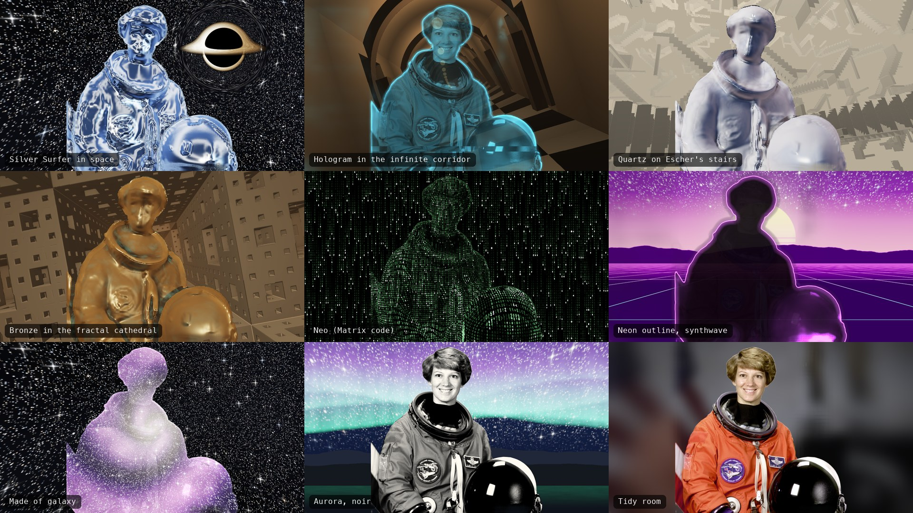

# Matrix Eyes Cam

A virtual webcam for macOS. Pick a background and what your silhouette becomes once, and every Google Meet / Zoom / FaceTime call starts with that look: you as liquid chrome in space, being bent and pulled in by a black hole; a hologram walking an endless twisting corridor; a quartz statue on Escher's stairs; or just you with a tidy, blurred room.



<sub>Rendered offline from the NASA portrait of astronaut Eileen Collins (public domain). In a call it's you, live.</sub>

It shares its engine and its settings panel with [Matrix Eyes](https://github.com/Narek-versatile/matrix-eyes-macos), the full-screen Matrix camera app: every look and every control exists in both.

## What's in it

**Backgrounds**

| Your room | Animated scenes | Impossible spaces |
| --- | --- | --- |
| Room as it is | Space (+ ray-traced black hole) | Infinite corridor: an arched hall that slowly twists, so the checkered floor climbs the walls |
| Blurred room (no halo around you) | Matrix rain | Escher stairs: staircases in every direction, slowly turning |
| Tidy room (soft, desaturated studio look) | Aurora, Synthwave | Fractal cathedral: an endless flight down a Menger-sponge tunnel |
| Room in your look (the whole room becomes code or a material, as in Matrix Eyes) | | |

**You**

| Mode | Options |
| --- | --- |
| As you are | colour grade: natural, noir, warm film, cyberpunk |
| Effect | edge glow, hologram, neon outline, pixelate, ghost trails; colour and strength |
| Material | Silver Surfer chrome, quartz statue, verdigris copper, bronze, doodle, 3D print |
| Fill | galaxy, fire, ocean, lava, or **your own image or looping video** |
| Matrix code | you, made of digital rain, shaped in 3D (green or amber, glyph size, rain speed) |

Looks are saved as presets (21 built in; the first eight are Matrix Eyes' keys 1–8), switchable from the window, the Look menu (⌘[ / ⌘]) or the menu bar. Your cut-out comes from Apple's person segmentation, materials and Matrix code use the Depth Anything V2 depth model on the Neural Engine, and everything renders with Metal at 1280×720, 30 fps (each frame takes 1–5 ms of GPU time on an M4).

People in the call see you **unmirrored**, so text on your shirt or a whiteboard reads correctly; the studio preview can be mirrored like a mirror.

## The black hole


<sub>Left: interactions off. Middle: gravity bends you, the disk lights you and you're pulled in. Right: the "Falling into the black hole" look.</sub>

With the space background the black hole is ray-traced (Schwarzschild lensing of the stars and the accretion disk), and it acts on you, each with a slider: **gravity bends you** (your silhouette is lensed when you get close), **pulls you in** (wisps of you spiral into it), **disk lights you** (warm light and a rim on the side facing it). **Drag** on the preview to move it, or set Position to *Orbits your head* and it circles you, following your face. Size is a slider too; ⌘B shows or hides it.

## Photos

**Take photo** (or ⇧⌘S) saves the call picture as a PNG, after an optional 3, 5 or 10 second countdown. The first photo asks which folder to use; change it under Photos.

## Status

| Part | State |
| --- | --- |
| Engine, all backgrounds and silhouettes, black hole interactions, presets | done |
| Studio app (preview, shared settings panel, photos, menu bar, clean output window) | done |
| Virtual camera extension + install flow | done (signed with a developer team, working in Meet) |
| Face-tracked avatars | next (phase 3) |

## Run the studio app

```bash
./build.sh
open "Matrix Eyes Cam.app"
```

Needs macOS 14+, Apple silicon and Xcode. The first build downloads Apple's [Depth Anything V2 Small for Core ML](https://huggingface.co/apple/coreml-depth-anything-v2-small) (49.8 MB, Apache-2.0) into `Models/` with `scripts/fetch-model.sh` and checks its SHA-256 hashes (a Matrix Eyes checkout in the folder above is reused instead). This unsigned build has everything except the virtual camera; its **Output** window (Virtual camera › Open clean output window) shows exactly the call picture.

## Build with the virtual camera (signed)

macOS only loads a camera extension that is signed by an Apple developer team with the system-extension entitlement.

1. Sign in to Xcode with the developer account: Xcode › Settings › Accounts.
2. Put the team's 10-character Team ID in `Signing.local.xcconfig` (ignored by git):
   ```bash
   echo 'DEVELOPMENT_TEAM = ABCDE12345' > Signing.local.xcconfig
   ```
3. Build and install into Applications:
   ```bash
   INSTALL=1 scripts/build-signed.sh
   ```
4. Open Matrix Eyes Cam from Applications and click **Install virtual camera**. macOS asks you to approve it in System Settings › General › Login Items & Extensions › Camera Extensions.
5. In Meet: Settings › Video › Camera › **Matrix Eyes Cam**.

When the app isn't running, the camera shows a card asking you to open it.

The project is generated by [XcodeGen](https://github.com/yonaskolb/XcodeGen) from `project.yml`; `scripts/build-signed.sh` runs it for you.

## The shared engine

`Sources/Engine` (camera, depth, cut-out, the Metal engine, presets, the settings panel) and `Resources/Shaders` are shared with Matrix Eyes. They're developed in this repo; after changing them, copy them over and build both apps:

```bash
scripts/sync-to-matrix-eyes.sh ../matrix-eyes-macos     # default: the folder above this repo
```

Each app keeps its own saved looks (`~/Library/Application Support/Matrix Eyes Cam` and `…/Matrix Eyes`).

## Developer checks

```bash
# one look on a still photo (prints GPU time per frame)
"Matrix Eyes Cam.app/Contents/MacOS/MatrixEyesCam" --render-test photo.png out.png look=17 bend=0.9

# the real app, fed a still photo instead of the camera; saves frames + the controls panel, then quits
MATRIX_CAM_TEST_IMAGE=photo.png MATRIX_CAM_SNAPSHOTS=/tmp/snaps "Matrix Eyes Cam.app/Contents/MacOS/MatrixEyesCam"
```

`--render-test` keys: `look=<1…21>` or `preset=<name>`, `bg` (room, blurred, tidy, sameAsYou, space, matrix, aurora, synthwave, corridor, stairs, cathedral), `subject` (real, effect, material, fill, matrix), `effect` (edgeGlow, hologram, neon, pixelate, ghost), `material` (chrome, quartz, copper, bronze, doodle, print), `fill` (media, galaxy, fire, ocean, lava), `grade` (natural, noir, warm, cyberpunk), `theme` (green, amber), `bh=0/1`, `hx`, `hy` (hole position, 0…1), `hsize`, `bend`, `pull`, `light`, `glow`, `rows` (glyph rows), `size=WxH`, `mirror=1`, `media=<image or video>`, `accent=r,g,b`, `t=<seconds>`. The snapshot run never saves your looks.

## Layout

```
Sources/Engine     shared with Matrix Eyes: camera, depth, person cut-out + face, the Metal engine, presets, media, settings panel
Sources/Studio     SwiftUI studio app, virtual-camera output, extension installer
Sources/Extension  the CoreMediaIO camera extension (source + sink streams)
Sources/Shared     identifiers shared by app and extension
Resources/Shaders  Metal source (.msl), concatenated at launch (shared with Matrix Eyes)
Signing/           entitlements and Info.plists for the signed build; Signing.xcconfig holds the team
scripts/           signed build, model download, sync of the shared engine into Matrix Eyes
```

See [PLAN.md](PLAN.md) for the decisions and phases.

## License

[MIT](LICENSE). The bundled depth model is Apache-2.0 (see [THIRD_PARTY_NOTICES.md](THIRD_PARTY_NOTICES.md)). "The Matrix" and its imagery belong to their owners; this project is an unaffiliated fan tribute.
